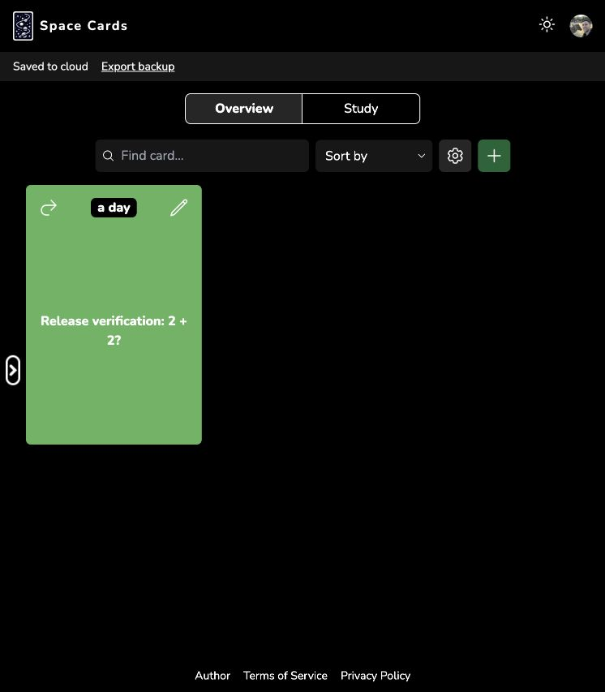
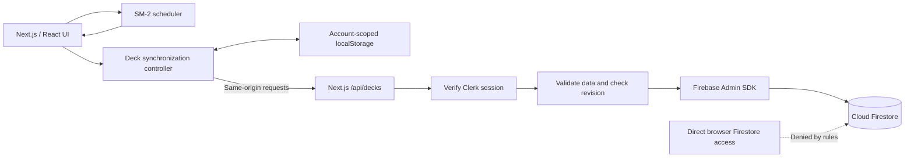

# Spaced Cards

A full-stack flashcard app for creating decks, practicing spaced repetition, and keeping study progress across sessions. Built as a portfolio project by [Gary Giambatista](https://gary-giambatista.com/).

**[Try the live app](https://spaced-cards-azure.vercel.app/)** · [Architecture and persistence](docs/cloud-persistence.md) · [SRS validation](docs/srs-validation.md)

## What it does

- Create and edit decks and cards, with optional hints, notes, and mirrored question/answer cards.
- Study due cards with reveal-before-rating and **Again / Hard / Good / Easy** responses.
- Practice as a guest with local browser storage, or sign in with Clerk for cloud persistence.
- See save status, retry failed cloud saves, and export the visible deck collection as JSON.
- Keep local data scoped to each account, with explicit imports for guest or older local decks.
- Detect competing saves instead of silently overwriting newer cloud changes.
- Use responsive layouts and light/dark themes.

## Preview

A test card after a successful review and reload: the next review is in a day, and the save indicator confirms cloud synchronization. The screenshot uses synthetic verification content.



## A two-minute demo

1. Open the [live app](https://spaced-cards-azure.vercel.app/) and create a deck. Guest mode saves locally in that browser.
2. Add a card, such as **“What is 2 + 2?” → “4”**. Add a hint or note if desired.
3. Select **Study**. Rating buttons stay disabled until you select **Flip** to reveal the answer.
4. Choose **Good**. The due count decreases, and the card receives its next review date.
5. Sign in to try cloud persistence. If offered, explicitly import your guest decks; they are not uploaded automatically.
6. Wait for **Saved to cloud**, then reload. Your cards and review schedule should remain. **Export backup** downloads the currently visible decks as JSON.

Use a separate browser profile to try cloud loading on another session. The app does not provide a public shared demo account.

## Engineering highlights

This project combines scheduling logic with the less visible work needed to preserve a user's progress:

- **A testable scheduler:** pure functions handle eligibility, review updates, and duplicate-review protection. Stored due dates are authoritative; due flags and counts are derived.
- **Server-side authorization:** the API verifies the Clerk session and derives the Firestore user path from that identity. A caller cannot choose another user's document path.
- **Conflict-aware persistence:** Firestore transactions check document revisions; a stale save receives a conflict response. The first server overwrite preserves the original document in a per-user backup.
- **Local recovery:** edits are cached before cloud synchronization. Failed requests retain local changes, and stale responses are ignored after an account switch.
- **Verification beyond unit tests:** emulator tests exercise real transactions and security rules. Live checks covered two-account separation and create/review/save/reload behavior.

## Architecture



The API's `X-Deck-Owner` header is an account-switch guard, **not an authorization credential**. The verified session determines ownership. Direct client Firestore access is denied; Firebase Admin bypasses those rules, so API authorization and service-account permissions remain essential.

### Stack

| Layer | Technology |
| --- | --- |
| Application | Next.js 16 App Router, React 19, JavaScript |
| Styling | Tailwind CSS 3, next-themes |
| Authentication | Clerk 7 |
| Persistence | localStorage, Cloud Firestore through Firebase Admin 14 |
| Spaced repetition | `supermemo` 2.0.17, implementing SM-2 |
| Testing | Jest 30, React Testing Library, Firebase Emulator Suite |
| Hosting/runtime | Vercel, Node.js 24 |

Exact versions are pinned in [production/package.json](https://github.com/gary-giambatista/spaced-cards/blob/production/package.json) and [production/package-lock.json](https://github.com/gary-giambatista/spaced-cards/blob/production/package-lock.json).

## Run locally

Use **Node.js 24** and npm. Create your own Clerk application; cloud development should use a separate Firebase development project, not the production database.

```bash
git clone https://github.com/gary-giambatista/spaced-cards.git
cd spaced-cards
git switch production
npm ci
cp .env.example .env.local
```

The deployed application is maintained on the **`production` branch**.

Configure `.env.local`:

| Variable | Purpose |
| --- | --- |
| `NEXT_PUBLIC_CLERK_PUBLISHABLE_KEY` | Public key for your Clerk application |
| `CLERK_SECRET_KEY` | Matching Clerk server key; never expose it to the browser |
| `FIREBASE_PROJECT_ID` | Your development Firebase project ID |
| `FIREBASE_SERVICE_ACCOUNT_JSON` | Server-only service-account JSON for that project; alternatively use configured Google Application Default Credentials |

For a local env file, wrap the complete JSON value in single quotes, keeping its JSON string contents and escaped `\n` sequences intact. For Vercel, paste the original JSON directly into the environment-variable value. Never commit credentials. The Firebase variables are required for signed-in cloud operations; guest decks use browser storage, but the app still requires Clerk configuration to initialize its authentication UI.

```bash
npm run dev
```

Open [localhost:3000](http://localhost:3000). For a production build:

```bash
npm run build
npm start
```

See [cloud persistence configuration](docs/cloud-persistence.md) for server permissions, security rules, preview isolation, and recovery details. A Firebase CLI login alone does not provide credentials to a deployed Vercel function.

## Tests and checks

```bash
npm test -- --runInBand
npm run lint
npm audit
npm run build
```

The normal test command skips emulator-only suites. To run everything, install the Firebase CLI and Java 21+, then run from the repository root:

```bash
firebase emulators:exec --only firestore --project demo-spaced-cards \
  'RUN_FIRESTORE_INTEGRATION=1 npm test -- --runInBand'
```

The integration tests require a localhost emulator and use the demo project; they do not contact production Firestore.

**Verified October 27, 2026:** 48 tests passed across 12 suites with the emulator; production builds succeeded; npm audit reported zero advisories. Lint had no errors and seven existing effect-state warnings. These are dated results, not a guarantee that future dependency audits will remain clean.

Coverage includes due-date boundaries, rating behavior, immutable edits, save/reload, failed-save recovery, account switching, API ownership checks, transaction conflicts, original-document backups, and denied direct Firestore access. Scheduling tests validate implementation behavior, not learning or retention outcomes.

## Design tradeoffs and limits

- **SM-2 today:** Again maps to grade 1, Hard to 3, Good to 4, and Easy to 5. Again currently schedules a one-day reset; there are no minute-based learning steps.
- **Bounded collections:** each user's decks are stored in a single document, with a 700 KB API request limit. This suits a small portfolio app; larger collections would need per-deck/card storage.
- **Explicit conflicts:** concurrent edits are detected, not automatically merged. Export local work before choosing the cloud copy.
- **Device privacy:** localStorage is not encrypted, and per-account recovery copies remain after sign-out. Account isolation in the UI does not protect against someone who controls that browser profile.
- **Backups:** the initial server-overwrite backup and JSON export are not a complete project-wide disaster-recovery system. There is no general JSON-file restore UI.
- **Maintenance:** this is a portfolio project, not a service with an uptime commitment. A publicly hosted auth/database application still requires occasional security and dependency review.

## Future enhancement: FSRS

**Planned exploration; not implemented or scheduled.** The current app uses the tested SM-2 scheduler. [ts-fsrs](https://github.com/open-spaced-repetition/ts-fsrs) is a potential replacement if the project evolves into an actively used study tool.

The goal would be to introduce FSRS scheduling and explicit learning/relearning states while preserving existing cards and keeping the four familiar rating buttons. This would require a data migration, not just a package replacement.

Proposed implementation stages:

1. **Introduce a scheduler boundary.** Keep the UI and persistence controller independent of the algorithm; add a versioned FSRS card representation and explicit rating mapping.
2. **Design a safe migration.** Preserve card content and export existing schedules before conversion. Decide how to initialize FSRS state for reviewed cards. The current app stores scheduling summaries rather than complete review history, so it cannot precisely reconstruct historical FSRS states.
3. **Persist review logs.** Record ratings, timestamps, and scheduler versions alongside updated card state. Revisit the single-document storage design before accumulating unbounded logs.
4. **Update the review experience.** Handle learning/relearning steps and short intervals; optionally preview the next interval for each rating.
5. **Validate and roll out gradually.** Test new, migrated, and overdue cards; date serialization; reloads; account isolation; conflicts; and duplicate reviews. Trial with test decks before migrating existing users, with a documented recovery path.

Acceptance criteria: no lost card content, an explicit migration policy for existing progress, durable review state across devices, and passing scheduler/persistence regression tests. Personalized parameter optimization would be a later step once sufficient review history exists—not a prerequisite for basic FSRS integration.

For the project's current portfolio scope, the working SM-2 implementation remains a deliberate choice. FSRS is a future extension, not a repair needed to make the current app functional.

## Implementation notes

- [Cloud persistence and recovery](docs/cloud-persistence.md)
- [SRS investigation and regression fixes](docs/srs-validation.md)
- [Dependency modernization](docs/dependency-modernization.md)
- [Historical Firestore rules audit](docs/security-rules-audit.md)
